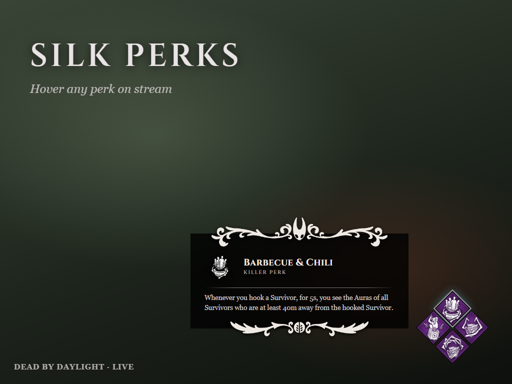
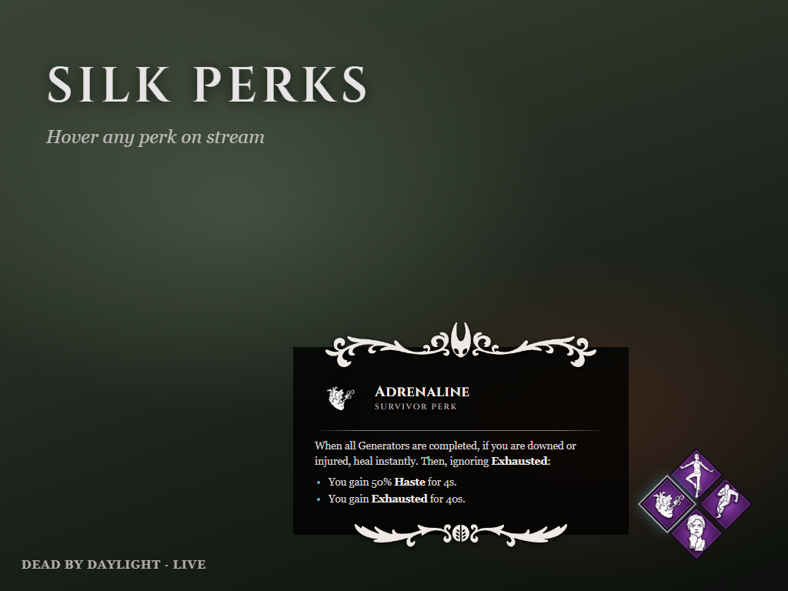

<h1 align="center">Silk Perks</h1>

A Twitch extension for Dead by Daylight streams: viewers hover your perks on stream and read what they do.

 

## Features

- **Perk tooltips:** hover any of the four perk diamonds on stream to see the perk's name and full description.
- **Killer info:** survivor streamers show which killer they're facing, and killer streamers let viewers hover their power icon. Either way, the tooltip shows the killer's power and perks.
- **Quick tips:** the streamer writes up to five short tips. Each viewer can minimize or hide the card for themselves.
- **Build presets:** save favorite builds and switch between them in one click from the live dashboard.
- **Panel and mobile view:** the current build, killer and tips appear below the stream and in the mobile app.
- **Live updates:** changes reach viewers instantly, with no stream restart.

## Get it

Search for **Silk Perks** in the Twitch Extensions directory (Creator Dashboard → Extensions), install it as an **Overlay**, then open **Configure** to pick your perks.

An optional **Silk Perks Helper** that reads your perks from the screen automatically is in the works. When it's ready, it will be on the [download page](https://dblazevic21.github.io/silk-perks/).

## Privacy

Silk Perks never collects viewer data. It shows only the build and tips the streamer sets. The optional helper will never read game memory, so it stays safe with Easy Anti-Cheat.

---

Made by Duje Blažević. Dead by Daylight is a trademark of Behaviour Interactive. This project is not affiliated with or endorsed by Behaviour Interactive or Team Cherry.

© 2026 Duje Blažević. All rights reserved.
